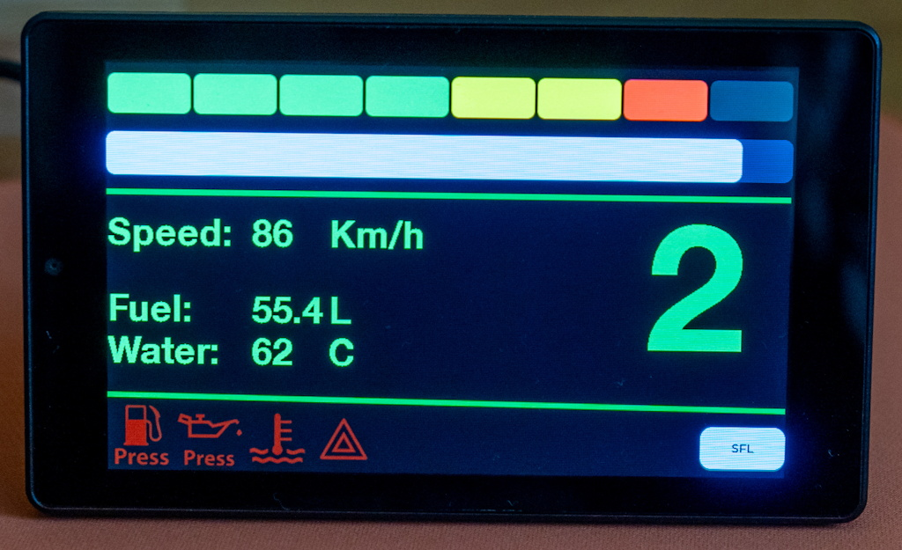

# iRDash_Client v4
Displays live data of iRacing telemetry using a touch sensitive TFT display.

## Gauges it can show
- RPM bar
- Eight segment Shift Light Indicator (blinking blue when limiter is active)
- Selected gear
- Fuel quantity
- Water temperature
- Speed
- Engine warning lights (Oil pressure, Fuel pressure, Water temperature, Stall)

## Supported cars
It supports multiple profiles to suit the different cars available in the sim. You can choose between them if you touch the profile name on the bottom right.
- Skip Barber (Skippy)
- Formula Renault 2.0
- Dallara Formula 3
- Super Formula Lights
- Cadillac CTS-V
- MX-5 (NC and ND)
- Toyota GR86
- BMW M2 CSR
- BMW M4 G82 GT4 evo          // updated for 2025 season 4
- Porsche 911 GT3 cup (992.1) // updated for 2024 season 4
- Porsche 911 GT3 cup (992.2)

## Display board
The program is developed for an 800x480 resolution touch screen.

Display module: Guition JC4880P443C:
- Size: 4.3"
- Resolution: 480x800
- Capacitive touch sensing
- Display driver IC: Sitronics ST7701 (interface: MIPI-DSI)
- Touch controller IC: Goodix GT911
- MCU: ESP32-P4 / C6

## Build instructions
Visual Studio Code board settings:
- Board: ESP32P4 Dev Module
- Chip revision: Before v3.00 (check your board with Espressif's flash download tool to know your exact version, Guition mounted my board with v1.3)
- Flash mode: QIO
- Flash Frequency: 80 MHz
- Flash Size: 16 MB (128 Mb)
- ESP PSRAM: support for external PSRAM enable
- SPI Flash driver: BOYA enable

To compile the app you need the below libraries:
- ESP-IDF 6.x https://github.com/espressif/esp-idf
  + ESP LCD ST7701(S)
  + ESP LCD Touch Component
  + ESP LCD Touch GT911 Controller
  + USB-SERIAL-JTAG
- LVGL v9.6 https://github.com/lvgl/lvgl

## Telemetry source
To display the live data of iRacing it needs the "iRDash Server" program running on Windows host and connected to the board via USB.
- https://github.com/UmmonPwr/iRDash-Server

## Screenshot
